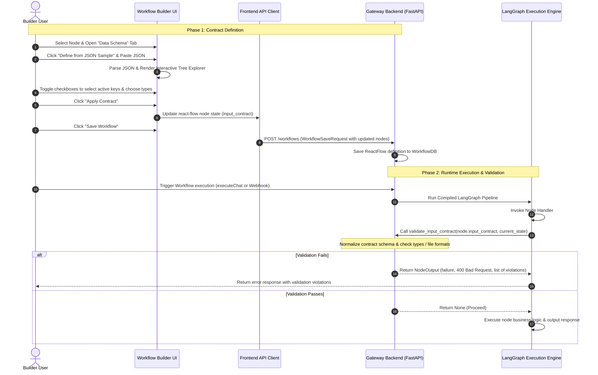

# Technical and Visual Design: Input/Output Contract Definition

This document details the complete technical design, visual UI/UX layout, and runtime execution flow for defining and validating simple and complex types, inspired by **n8n** and **Zapier**.

---

## 1. Data Type Representation (n8n & Zapier Alignment)

In modern workflow builders, data payloads contain both simple primitives and complex file objects. We map these to standard formats under the hood while maintaining a user-friendly field-selection interface.

### Simple Types

Simple types map to standard JSON Schema types with specific semantic formats for validation:

- **String formats**: `email`, `phone`, `ip_address`, `url`, `uuid`, `date`, `datetime`.
- **Numeric primitives**: `integer`, `number` (with min/max boundaries).
- **Boolean & raw JSON**: `boolean`, `json` (generic parsed object).

### Complex Types (Files & Binary Data)

To handle files (like `pdf`, `doc`, `image`), we introduce a custom type alias `file`.
A `file` in the gateway can be passed in two ways:

1. **URI/Path String**: A path to local storage, a remote URL, or a `data:image/png;base64,...` data URI.
2. **Metadata Dictionary**: A structured object containing file info:
   ```json
   {
     "file_path": "path/to/file.pdf",
     "file_name": "report.pdf",
     "mime_type": "application/pdf",
     "size": 10245
   }
   ```
   Both formats are natively resolved and validated against the format specified (e.g. `pdf` checks if the extension is `.pdf` or mime-type is `application/pdf`).

---

## 2. Sequence Diagram (Runtime Flow)

The diagram below represents how contracts are defined in the builder and validated during runtime workflow execution:



---

## 3. Visual UI Design (Wireframe & Layout)

Below is the visual layout design for the interactive **JSON Payload Selector Modal** that will be built using modern, premium aesthetics (dark header, glassmorphism, clean typography, dynamic badge colors).

```
+--------------------------------------------------------------------------------------------------+
|  [Icon] Define Schema from JSON Sample                                                       [X] |
+--------------------------------------------------------------------------------------------------+
| Paste a sample JSON payload below to automatically infer fields, toggle active data elements,   |
| and configure verification types.                                                                |
+--------------------------------------------------------------------------------------------------+
|  RAW JSON SOURCE TEXTAREA                        |  INTERACTIVE SCHEMA GENERATOR & TREE EXPLORER |
|  +--------------------------------------------+  |  +-----------------------------------------+ |
|  | {                                          |  |  | [x] data                   (object)     | |
|  |   "data": {                                |  |  |   |-[x] chunks             (array)      | |
|  |     "chunks": ["hello"],                   |  |  |   |-[x] chunk_count        (integer)    | |
|  |     "chunk_count": 1,                      |  |  |   |-[x] strategy           (string)     | |
|  |     "strategy": "recursive",               |  |  |   |-[x] chunk_size         (integer)    | |
|  |     "chunk_size": 1000,                    |  |  |   \-[x] chunk_overlap      (integer)    | |
|  |     "chunk_overlap": 200                   |  |  | [x] auth_token             (string)     | |
|  |   },                                       |  |  | [x] source_system          (string)     | |
|  |   "auth_token": "token",                   |  |  +-----------------------------------------+ |
|  |   "source_system": "localhost"             |  |  SELECTED FIELD SETTINGS                   | |
|  | }                                          |  |  +-----------------------------------------+ |
|  +--------------------------------------------+  |  | Field Path: data.chunks                 | |
|  | [Icon] Valid JSON Detected                 |  |  | Target Type: [ Array (string)  v ]      | |
|  +--------------------------------------------+  |  | [ ] Required / Mandatory Field          | |
|                                                  |  +-----------------------------------------+ |
+--------------------------------------------------------------------------------------------------+
|                                                           [ Cancel ] [ Generate & Apply Schema ] |
+--------------------------------------------------------------------------------------------------+
```

### Aesthetic Specifications:

1. **Interactive Tree**: Collapsible nested layers with visual guide lines (`|-`, `\-`) and colors matching our categories (indigo/emerald text, soft gray borders).
2. **Dynamic Selection**: Checking a parent object automatically select/deselects children (with manual overrides allowed).
3. **Type Badges**: Pill-shaped badges with custom tailwind gradients (e.g. `bg-purple-50 text-purple-600` for objects/arrays, `bg-blue-50 text-blue-600` for simple strings, and `bg-emerald-50 text-emerald-600` for file types).
4. **Validation Preview**: A live JSON preview pane that updates in real-time as checkboxes are clicked, displaying the actual JSON schema output.

---

## 4. Inferred Contract Schema Output

When the user pastes the example JSON and applies the schema, it generates the following normalized **JSON Schema Contract** that is saved on the node instance:

```json
{
  "type": "object",
  "properties": {
    "data": {
      "type": "object",
      "properties": {
        "chunks": {
          "type": "array",
          "items": { "type": "string" }
        },
        "chunk_count": { "type": "integer" },
        "strategy": { "type": "string" },
        "chunk_size": { "type": "integer" },
        "chunk_overlap": { "type": "integer" }
      },
      "required": ["chunks", "chunk_count"]
    },
    "auth_token": { "type": "string" },
    "source_system": { "type": "string" }
  },
  "required": ["data", "auth_token"]
}
```

---

## 5. Input Contract Value Assignment & Output-to-Input Mapping Protocol (n8n & Zapier Model — EPIC-PROPS-CONTRACT-001)

Every operational parameter required by a node at execution time (for example, MySQL `query_type`, `table_name`, `query`, `fields`, `condition`, `condition_params`) is defined as a rule in the node's `input_contract`.

### A. Admin Schema & Allowed Values (`/admin/nodes`)
In `/admin/nodes`, System Admins and Tenant Admins can define on each `input_contract` rule:
- **`field_name` & `field_type`**: Name and primitive/complex type (`string`, `number`, `integer`, `boolean`, `object`, `array`, `enum`, `json`, etc.).
- **`allowed_values` (Dropdown Options)**: Optional array of valid values (e.g., `["select", "insert", "update", "delete", "raw"]` for `query_type`).
- **`default`**: Optional default value applied when the field is omitted at runtime (e.g., `"select"`).

### B. The Inline & Full-Screen Mapping Interface (`PropertiesPanel.tsx` & `FieldMapperModal.tsx`)

When a Workflow Designer selects a node on the canvas:

1. **Inline Input Parameters (`PropertiesPanel.tsx`)**:
   - Every field in the node's `input_contract` is rendered directly in the sidebar under **Input Parameters (`input_contract`)** (and in the full-screen `FieldMapperModal`).
   - Each field supports two modes via a **[Fixed | Map `{}`]** toggle:
     - **Fixed Value Mode**: The user enters a static constant directly in the typed input control (a `<select>` dropdown when `allowed_values` is defined, a boolean toggle, number input, SQL/multiline textarea, JSON input, or text input—e.g. `query_type = "select"`, `table_name = "users"`).
     - **Map `{}` Mode (Upstream `output_contract` / `state` Picker)**: The user clicks `{}` to open the **Source Fields Popover**, populated by the connected upstream node's `output_contract` fields and shared workflow `state` variables. Selecting a source field inserts a Jinja2 expression (e.g., `{{ user_id }}` or `{{ state.tenant_id }}`).
2. **Persistence**:
   - Both Fixed values and `{{ ... }}` mapped expressions are persisted in the workflow node's `properties.mapping_template` dictionary via `PUT /workflows/{workflow_id}/nodes/{agent_node_id}/properties`.

### C. Mapping Resolution Engine (`BaseNode.run()` Backend Runtime)

During execution of a node:

1. The backend loads the node's properties, including `mapping_template` (a JSON dictionary/string defining Fixed values and Jinja mappings for `input_contract` fields).
2. The backend constructs a `render_context` dictionary containing upstream `input_data` keys (both at top-level and under `input_data`/`data`), shared `state`, `context`, and `metadata`.
3. The backend resolves `mapping_template`:
   - Static/fixed values remain intact.
   - String values containing `{{ ... }}` are compiled and rendered using `Jinja2` against `render_context`.
4. When `input_data` is a dictionary and `resolved_mapping` is a dictionary, the backend merges `{ **input_data, **resolved_mapping }` (and applies any `input_contract` rule `default` values for missing keys) so unmapped upstream fields pass through while configured Fixed and Mapped `input_contract` values take precedence before `validate_input()` and `execute()` run.
