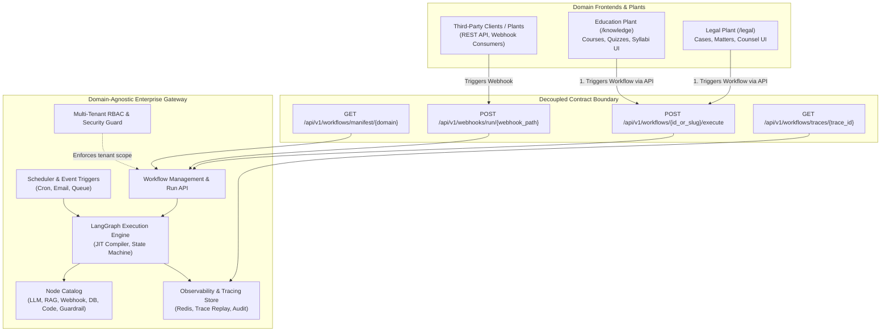

# EPIC: Decoupling Gateway Workflow Engine from Domain Plants

## Document Metadata
* **Epic ID:** EPIC-ARCH-001
* **Title:** Domain-Agnostic Gateway & Decoupled Domain Plants (Legal, Education/Knowledge)
* **Status:** Proposed / Under Review
* **Target Version:** v0.4.0
* **Author:** AdI Tech Developer (Architect)

---

## 1. Problem Statement & Motivation

Currently, the Enterprise LLM Gateway repository mixes two distinct architectural concerns:
1. **Core Gateway & Workflow Engine:** Workflow creation, graph compilation, node execution, runtime scheduling, triggers/webhooks, observability, multi-tenant RBAC, and model routing.
2. **Domain-Specific Logic & Plants:** Domain vertical applications such as `/legal` (matter intake, court case management, precedent search, statutory mapping) and `/knowledge` (education, document RAG). Domain routes (`/api/v1/legal/...`) and models are baked directly into the core gateway backend.

### Deficiencies:
- **Coupling:** Adding or modifying a domain vertical requires modifying core Gateway backend routers and models.
- **Not Domain Agnostic:** Core gateway cannot be shipped as a standalone, domain-agnostic workflow orchestrator.
- **Workflow Under-utilization:** Instead of leveraging dynamic workflow execution graphs, domain features use hardcoded procedural services.
- **Scalability & Deployment:** Frontends and backends cannot be deployed as independent plants or serverless microservices.

---

## 2. Target Architecture & Boundaries



---

## 3. Core Principles

1. **Gateway is 100% Domain-Agnostic:**
   - Zero domain-specific endpoints (`/legal`, `/education`) inside gateway core.
   - Gateway operates strictly on schemas, nodes, triggers, workflows, and traces.
2. **Workflow as Universal Execution Unit:**
   - Any domain task (e.g. Legal Matter Analysis, Statute Lookup, Quiz Evaluation) is authored and executed as a Gateway Workflow.
3. **First-Class Workflow Execution API:**
   - Standard endpoint: `POST /api/v1/workflows/{workflow_id_or_slug}/execute`
   - Accepts arbitrary validated input payload matching workflow input contract.
   - Supports synchronous and asynchronous execution modes.
4. **Domain Plants as Independent Entities:**
   - Plants manage domain UI and user journeys.
   - Plants delegate computation and LLM orchestration to Gateway workflows.
   - Plants can run as separate deployment plants (separate port/subdomain/container) or modular apps.

---

## 4. User Journeys & Workflow Integration

### User Journey 1: Legal Counsel Matter Analysis
1. Counsel submits matter description or document on Legal Plant UI (`/legal/intake`).
2. Legal Plant invokes Gateway API:
   ```http
   POST /api/v1/workflows/legal-matter-analysis/execute
   Authorization: Bearer <tenant_jwt>
   Content-Type: application/json

   {
     "input_data": {
       "raw_text": "Commercial petition breach of contract...",
       "input_mode": "document"
     },
     "async_mode": false
   }
   ```
3. Gateway executes workflow graph (Guardrail Node -> Entity Extraction Node -> Statute Mapping Node -> Precedent Search Node).
4. Gateway returns output payload with trace ID.
5. Legal Plant displays analysis and stores case record in tenant domain state.

### User Journey 2: Education Quiz & Syllabus Generation
1. Educator submits textbook chapter on Education Plant UI (`/knowledge/syllabus`).
2. Education Plant invokes Gateway API:
   ```http
   POST /api/v1/workflows/syllabus-curriculum-generation/execute
   Authorization: Bearer <tenant_jwt>
   Content-Type: application/json

   {
     "input_data": {
       "topic": "Quantum Computing 101",
       "target_level": "Undergraduate"
     }
   }
   ```
3. Gateway compiles and runs Education Workflow graph.
4. Gateway outputs structured modules and quizzes to Education Plant.

---

## 5. Gateway Backend API Specification

### 5.1 Execute Workflow (Sync / Async)
- **Endpoint:** `POST /api/v1/workflows/{workflow_id}/execute`
- **Alternative (Slug/Alias):** `POST /api/v1/workflows/run/{workflow_slug}`
- **Security:** JWT Authentication + Tenant Entitlement + Role Verification.
- **Request Body:**
  ```json
  {
    "input_payload": { ... },
    "execution_mode": "sync", // "sync" | "async"
    "metadata": {
      "caller_domain": "legal",
      "correlation_id": "req-12345"
    }
  }
  ```
- **Response (Sync):**
  ```json
  {
    "status": "completed",
    "workflow_id": "wf-legal-intake-v1",
    "trace_id": "trace-987654321",
    "latency_ms": 1420,
    "result": {
      "summary": "...",
      "statutes": [...],
      "risk_flags": [...]
    }
  }
  ```
- **Response (Async):**
  ```json
  {
    "status": "accepted",
    "workflow_id": "wf-legal-intake-v1",
    "trace_id": "trace-987654321",
    "poll_url": "/api/v1/workflows/traces/trace-987654321"
  }
  ```

### 5.2 Workflow Trace & Polling
- **Endpoint:** `GET /api/v1/workflows/traces/{trace_id}`
- **Response:** Current trace state, node execution history, errors, outputs.

---

## 6. Minimalist UI Wireframes

### Wireframe 1: Decoupled Domain Plant Shell (Responsive, Relative Layout)
```
+-------------------------------------------------------------------------------+
| [Brand / Domain: Legal Plant | Tenant: AZB Legal]        [User | Switch Domain]
+-------------------------------------------------------------------------------+
| +-- Sidebar -------------+ +-- Main Domain Workspace -----------------------+ |
| | (Briefcase) Matters    | |  +-- Hero Action Header ---------------------+  | |
| | (Folder) Cases         | |  | Active Matter Intake                      |  | |
| | (Scale) Statutes       | |  +-------------------------------------------+  | |
| | (Search) Precedents    | |  +-- Dynamic Workflow Trigger Card --------+  | |
| | (FileText) Drafts      | |  | [ Input Form: Matter Text / File Upload ] |  | |
| |                        | |  |                                           |  | |
| | (Server) Gateway Status| |  | [ Action: Run Legal Workflow ]            |  | |
| |   Connected: :8000     | |  +-------------------------------------------+  | |
| |                        | |  +-- Output Canvas (Powered by Gateway Trace)+  | |
| | (Settings) Config      | |  | [ Results / Precedents / Guardrail Output ]|  | |
| +------------------------+ +------------------------------------------------+ |
+-------------------------------------------------------------------------------+
```

---

## 7. Migration & Phasing Strategy

### Phase 1: Gateway Workflow Execution API (Core Backend)
- Implement `POST /api/v1/workflows/{workflow_id}/execute` in `backend/app/api/workflows/router.py`.
- Support slug/alias mapping for stable domain invocations.
- Ensure strict multi-tenant authorization (`customer_id` check against workflow and nodes).
- Unit & integration tests in `TESTDB`.

### Phase 2: Domain Workflow Seed & Extraction
- Convert existing hardcoded procedural legal pipelines into reusable Gateway Workflows (stored as standard `WorkflowDB` definitions).
- Package legal/domain-specific nodes as standard nodes in the Node Registry or dedicated plugin.

### Phase 3: Domain Plant Client Decoupling (Frontend)
- Update `/legal` and `/knowledge` frontends to call the Gateway Workflow Execution API via standard client.
- Decouple domain frontend routes so they can operate as independent plants pointing to Gateway URL (`GATEWAY_API_URL`).

---

## 8. Acceptance Criteria

1. **AC-1:** Core Gateway does not require domain-specific hardcoded routes (`/api/v1/legal`) to execute domain logic.
2. **AC-2:** `POST /api/v1/workflows/{workflow_id_or_slug}/execute` successfully accepts payloads, executes graphs in LangGraph engine, and returns results.
3. **AC-3:** Tenant scoping (`customer_id`) is strictly enforced; tenants cannot execute disabled nodes or other tenants' workflows.
4. **AC-4:** Domain frontends (`/legal`, `/knowledge`) execute domain tasks by invoking Gateway workflows over HTTP/REST.
5. **AC-5:** All tests run and pass using `TESTDB`.

