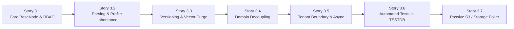

# EPIC: RAG Ingestion Node, Document Versioning & Domain Schema Decoupling

## Document Metadata
* **Epic ID:** EPIC-RAG-003
* **Title:** Workflow RAG Ingestion Node (`BaseNode`), Document Versioning & Domain Schema Decoupling
* **Status:** In Review / Updated with User Feedback
* **Target Version:** v0.4.0
* **Author:** AdI Tech Developer (Architect) & Product Manager
* **Predecessor:** EPIC-AUTH-001 (Unified API Key Auth Middleware)

---

## 1. Problem Statement & Motivation

Enterprise LLM Gateway workflows currently support knowledge retrieval (`KnowledgeRetrievalNode`, `RAGNode`), but have **no workflow node for ingesting documents** directly into tenant knowledge bases.

### Key Deficiencies Addressed:
1. **No Ingestion Node in Workflow Palette:** Workflow designers cannot build automated data-intake pipelines (e.g. Email attachment / S3 drop -> Ingest to KB -> Summarize).
2. **Headless Ingestion via Workflow Execution Blocked:** External systems calling workflows via `X-API-Key` cannot upload or index documents as part of their business logic.
3. **Missing Document Versioning:** Re-uploading an updated or amended document results in duplicate chunks or fails. Gateway needs in-place vector purging and chunk updates.
4. **Hardcoded Domain Schema Coupling:** `DocumentIngestionService` tightly couples ingestion to `DomainSchemaDB` and hardcoded legal domain keys. Gateway must be **100% domain-agnostic**: tenant only has a domain marker (`customer.domain`), while extraction logic belongs in downstream prompt nodes or external client plants (`client/legal`).
5. **Passive Ingestion Sources:** Need an automated mechanism to ingest documents from passive shared sources (S3 buckets, shared folders) via scheduled polling or events with sync ledger tracking.

---

## 2. Personas & User Journeys

### Persona 1: Workflow Designer (Tenant Designer)
* **Canvas Journey:**
  1. Opens `/workflow` canvas. Permission checked (`workflow:edit`, `workflow:create`, or `workflow:*`).
  2. Drags `RAG Document Ingestion` node from the **Knowledge** group into workflow.
  3. Configures Target Knowledge Base. Node automatically resolves and displays the bound LLM Profile parameters (embedding model, dimension, chunk size/overlap) as read-only badges. No manual chunking re-entry.
  4. Selects versioning strategy (`replace_chunks` vs `new_version`).
  5. Connects inputs (`document_content`, `document_name`, `document_version`, `metadata`) and tests node in isolation.

### Persona 2: External System / Decoupled Client (`client/legal`) via M2M API
* **API Journey:**
  1. Sends HTTP request with `X-API-Key`:
     ```http
     POST /workflows/ingestCourtDocument/execute HTTP/1.1
     Host: gateway.enterprise.local
     X-API-Key: gw_live_tenant_key_12345
     Content-Type: application/json

     {
       "input_data": {
         "document_content": "Base64... or raw text",
         "document_name": "Case_1092_Ruling.pdf",
         "external_document_id": "case_1092_v2",
         "document_version": 2,
         "mime_type": "application/pdf",
         "metadata": { "case_number": "1092/2026", "jurisdiction": "Supreme Court" }
       },
       "execution_mode": "sync"
     }
     ```
  2. Auth middleware verifies API key and role permissions (`workflow:execute` or `workflow:*`).
  3. Node checks version: purges obsolete version 1 chunks from Qdrant and SQL, chunks new version 2, embeds via tenant LLM Profile, upserts vectors to Qdrant, updates `KnowledgeDocumentDB`.
  4. Returns created/updated `document_id`, `version`, `chunk_count`, and `status: "indexed"`.

### Persona 3: Tenant Admin
* **Admin Journey:**
  1. Navigates to `/admin`.
  2. Manages LLM Profiles (embedding models, dimensions, vector DB presets) and tests profiles against sample workflows.
  3. Binds Knowledge Bases to LLM Profiles without rigid `DomainSchemaDB` requirements.

---

## 3. Architecture & Technical Specification

### 3.1 Node Architecture (`BaseNode` Extension)
* **Class:** `RAGIngestionNode(BaseNode)`
* **File Location:** `backend/app/nodes/built_in/kb/rag_ingestion_node.py`
* **Node Metadata:**
  * `name`: `"rag_ingestion"`
  * `label`: `"RAG Document Ingestion"`
  * `description`: `"Ingest, chunk, embed, and version documents into tenant knowledge bases."`
  * `category`: `"Data Operations"`
  * `group`: `"Knowledge"`
  * `node_type`: `"Node"`
  * `icon`: `"file-up"`
  * `color`: `"#10B981"`
  * `version`: `"1.0.0"`

### 3.2 Property Schema (`user_properties`)
*Inherits parameters from the target KB's bound LLM Profile.*
```json
[
  {
    "key": "knowledge_base_id",
    "label": "Target Knowledge Base",
    "type": "source",
    "source": "/api/knowledge/bases",
    "required": true,
    "description": "Select the Knowledge Base. Inherits embedding model and chunking defaults from its bound LLM Profile."
  },
  {
    "key": "execution_mode",
    "label": "Execution Mode",
    "type": "select",
    "options": ["sync", "async"],
    "default": "sync",
    "description": "Sync waits for vector indexing; async returns queued job ID immediately."
  },
  {
    "key": "versioning_strategy",
    "label": "Versioning Strategy",
    "type": "select",
    "options": ["replace_chunks", "new_version", "skip_if_exists"],
    "default": "replace_chunks",
    "description": "replace_chunks purges old vectors and updates chunks; new_version preserves revision history."
  }
]
```

### 3.3 Data Contracts
* **Runtime Input Contract (`input_contract`):**
  ```json
  {
    "type": "object",
    "properties": {
      "document_content": { "type": "string", "description": "Raw text, Base64 data string, or file path" },
      "document_name": { "type": "string", "description": "Filename or identifier (e.g. file.pdf)" },
      "external_document_id": { "type": "string", "description": "Caller document ID for tracking and version updates" },
      "document_version": { "type": "integer", "default": 1, "description": "Document version number" },
      "knowledge_base_id": { "type": "string", "description": "Optional runtime override for target KB ID" },
      "mime_type": { "type": "string", "description": "Optional MIME type (application/pdf, text/plain, etc.)" },
      "metadata": { "type": "object", "description": "Optional custom metadata dictionary to attach to chunks and document" }
    },
    "required": ["document_content"]
  }
  ```
* **Runtime Output Contract (`output_contract`):**
  ```json
  {
    "type": "object",
    "properties": {
      "document_id": { "type": "string", "description": "Created or updated KnowledgeDocumentDB UUID" },
      "external_document_id": { "type": "string", "description": "Caller document identifier" },
      "document_version": { "type": "integer", "description": "Active document version" },
      "status": { "type": "string", "enum": ["indexed", "queued", "version_updated", "skipped", "failed"] },
      "chunk_count": { "type": "integer", "description": "Active chunks indexed into vector store" },
      "previous_chunks_purged": { "type": "integer", "description": "Number of stale chunks deleted from vector store" },
      "collection_name": { "type": "string", "description": "Vector store collection name" },
      "checksum": { "type": "string", "description": "SHA-256 hash" },
      "job_id": { "type": "string", "description": "Background indexing job ID (if async)" },
      "metadata": { "type": "object", "description": "Persisted document metadata" }
    },
    "required": ["document_id", "status"]
  }
  ```

### 3.4 In-Place Chunk Replacement on Version Update
* When document already exists in KB:
  * Deletes previous vectors from Qdrant by filter `document_id == doc.id`.
  * Deletes previous chunk records from `KnowledgeChunkDB`.
  * Increments `KnowledgeDocumentDB.version = new_version`.
  * Chunks and embeds new content; inserts fresh vectors into Qdrant. Zero orphan vectors.

### 3.5 Complete Elimination of `DomainSchemaDB`
* `DomainSchemaDB` is deprecated. Core Gateway is 100% domain-agnostic.
* Ingestion performs no mandatory domain schema queries or prompt-based entity extraction.
* Tenant domain is represented solely by `CustomerDB.domain = "legal"`, `"finance"`, etc.

---

## 4. Stories Breakdown

* **Story 3.1: Core `RAGIngestionNode` (`BaseNode` Subclass) & Schema Registry**
  * Subclass `BaseNode` in `backend/app/nodes/built_in/kb/rag_ingestion_node.py`.
  * Implement `init()`, `validate_input()`, workflow execution permission checks (`workflow:execute` / `workflow:*`).
* **Story 3.2: Content Parsing & Profile Inheritance**
  * Support raw UTF-8 text and Base64 payloads.
  * Inherit `chunk_size` and `chunk_overlap` from target KB's bound `LLMProfileDB`.
* **Story 3.3: Document Versioning & Vector Replacement Engine**
  * Implement document revision tracking and stale vector purging on updates in Qdrant and SQL.
* **Story 3.4: Complete Deprecation & Removal of `DomainSchemaDB` Coupling**
  * Remove domain extraction from `DocumentIngestionService`. Ingestion is 100% domain-agnostic.
* **Story 3.5: Multi-Tenant Boundary & Async Job Support**
  * Strict `customer_id` validation; async background indexing option via `JobService`.
* **Story 3.6: Unit & Integration Tests in `TESTDB`**
  * Comprehensive test suite in `backend/tests/test_rag_ingestion_node.py`.
* **Story 3.7: `S3WatcherNode` (Workflow Source / Trigger Node) & Admin Source Provenance Display**
  * Implement `S3WatcherNode` (`BaseNode` extension) to discover, view, and stream S3 documents to `RAGIngestionNode` with sync ledger (`IngestionSourceLedgerDB`).
  * Persist `source_uri` on `KnowledgeDocumentDB` and display Ingestion Source column in `/admin` Knowledge Base document view.

---

## 5. Implementation Sequence


