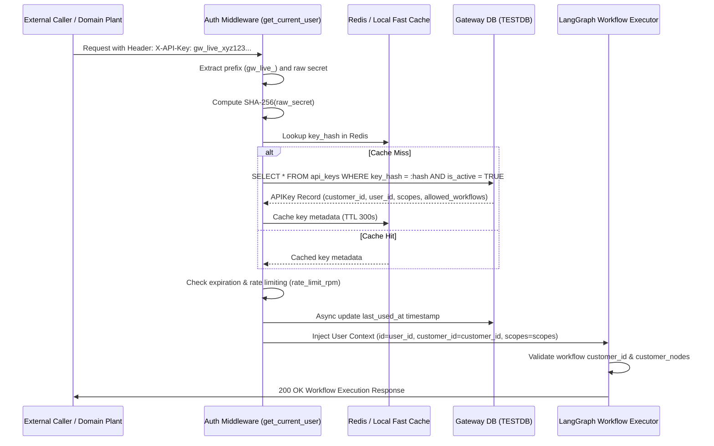

# EPIC: Unified API Key Management & High-Performance Auth Middleware

## Document Metadata
* **Epic ID:** EPIC-AUTH-001
* **Title:** Tenant-Scoped API Key Management & Unified Auth Middleware
* **Status:** Proposed / Under Review
* **Target Version:** v0.4.0
* **Author:** AdI Tech Developer (Architect)
* **Predecessor:** ARCH-SPEC-2026-001-REV2

---

## 1. Problem Statement & Motivation

Currently, the Enterprise LLM Gateway authorization layer in `backend/app/api/auth/dependencies.py` exclusively accepts short-lived JWT bearer tokens generated from interactive user sessions and browser cookies.

### Current Deficiencies:
1. **Headless & Machine-to-Machine Integration Blocked:** External systems (CRMs, ERPs, background workers, decoupled client plants like `client/legal`) cannot invoke Gateway workflow execution (`POST /api/v1/workflows/{id}/execute`) without maintaining active browser sessions or spoofing JWT login endpoints.
2. **Orphaned API Key Table:** The existing `backend/app/models/api_keys.py` model is an incomplete stub without foreign keys to `customers` (tenants) or `users`, without hashed storage, and without permission scope attributes.
3. **Missing Authentication Hook:** When an external consumer supplies an `X-API-Key` or `Authorization: Bearer gw_live_...` header, `get_current_user` attempts to decode it as a JWT and returns `401 Unauthorized`.
4. **No Tenant Key Governance:** Tenant Admins have no UI or API endpoints in `/admin` to generate, inspect, rotate, scope, rate-limit, or revoke API keys.

---

## 2. Personas & User Journeys

### Persona 1: External Client / CRM System (Machine-to-Machine)
* **Goal:** Execute the `getCustomerInformationFromCRM` workflow synchronously to extract customer data.
* **Journey:**
  1. Issues an HTTP request:
     ```http
     POST /api/v1/workflows/getCustomerInformationFromCRM/execute HTTP/1.1
     Host: gateway.enterprise.local
     X-API-Key: gw_live_a8f9c1d2e3f4b5a6c7d8e9f0
     Content-Type: application/json

     {
       "input_data": { "account_id": "ACC-1092" },
       "execution_mode": "sync"
     }
     ```
  2. Gateway auth middleware computes SHA-256 hash of the key, verifies active status, extracts `customer_id`, validates workflow access and node entitlements.
  3. Execution runs inside tenant boundary and returns structured JSON with trace ID.

### Persona 2: Tenant Administrator (Customer Admin)
* **Goal:** Provision a secure API key for the internal Legal Client application with restricted permissions.
* **Journey:**
  1. Tenant Admin logs into `/admin` and navigates to **API Keys** (`/admin/api-keys`).
  2. Clicks **Generate New API Key**.
  3. Enters key name (e.g. `Legal Plant Service Account`), selects scopes (`workflow:execute`, `knowledge:ingest`), and optionally restricts to specific workflow IDs.
  4. System generates secret key `gw_live_...`, saves only its SHA-256 hash, and displays the plaintext key once in a modal with a copy button.
  5. Admin distributes the key to the legal plant service environment.
  6. Admin can revoke or update rate limits at any time from the dashboard.

---

## 3. Architecture & Security Flow



---

## 4. Detailed Stories & Acceptance Criteria

### Story 1.1: Database Schema & Migration for Tenant-Scoped API Keys
* **Description:** Refactor `api_keys` table to be fully multi-tenant, relational, secure, and scoped.
* **Schema Definition:**
  ```sql
  CREATE TABLE api_keys (
      id VARCHAR(36) PRIMARY KEY, -- UUIDv7
      customer_id INT NOT NULL,
      user_id VARCHAR(36) NOT NULL,
      name VARCHAR(255) NOT NULL,
      key_prefix VARCHAR(16) NOT NULL, -- e.g. 'gw_live_a8f9c1d2' (first 16 chars for display)
      key_hash VARCHAR(64) NOT NULL UNIQUE, -- SHA-256 hex string (64 characters)
      scopes JSON NOT NULL, -- e.g. ["workflow:execute", "knowledge:ingest"]
      allowed_workflow_ids JSON NULL, -- NULL = all tenant workflows; or ["wf-1", "wf-2"]
      rate_limit_rpm INT DEFAULT 60,
      -- TODO: Future Enhancement: IP CIDR allowlisting
      allowed_ips JSON NULL, -- e.g. ["203.0.113.50/32", "10.0.0.0/8"] (NULL = allow any IP)
      is_active BOOLEAN DEFAULT TRUE,
      expires_at TIMESTAMP NULL,
      last_used_at TIMESTAMP NULL,
      created_at TIMESTAMP DEFAULT CURRENT_TIMESTAMP,
      updated_at TIMESTAMP DEFAULT CURRENT_TIMESTAMP ON UPDATE CURRENT_TIMESTAMP,
      CONSTRAINT fk_api_keys_customer FOREIGN KEY (customer_id) REFERENCES customers(id) ON DELETE CASCADE,
      CONSTRAINT fk_api_keys_user FOREIGN KEY (user_id) REFERENCES users(id) ON DELETE CASCADE
  );

  CREATE UNIQUE INDEX idx_api_keys_hash ON api_keys(key_hash);
  CREATE INDEX idx_api_keys_customer ON api_keys(customer_id);
  ```
* **Acceptance Criteria:**
  - **AC-1.1.1:** Table creates cleanly in MySQL and SQLite (`TESTDB`).
  - **AC-1.1.2:** Deleting a customer or user cascades and removes associated API keys.
  - **AC-1.1.3:** Raw secret keys are never stored; only cryptographic SHA-256 hashes are persisted.

---

### Story 1.2: Cryptographic Generator & Hashing Utilities
* **Description:** Implement secure key generation, prefix extraction, and constant-time hashing utility module in `backend/app/core/security/api_key_auth.py`.
* **Key Format Specification:**
  - Standard format: `gw_live_` + 32 cryptographically secure random url-safe characters (e.g., `gw_live_4kM9zB...`).
  - Prefix stored for human recognition: `gw_live_` + first 8 random characters.
* **Utility Interface:**
  ```python
  def generate_api_key() -> Tuple[str, str, str]:
      """Returns: (plaintext_key, key_prefix, key_hash)"""

  def hash_api_key(plaintext_key: str) -> str:
      """Returns SHA-256 hex string."""
  ```
* **Acceptance Criteria:**
  - **AC-1.2.1:** Uses `secrets.token_urlsafe` for entropy.
  - **AC-1.2.2:** Hash operation produces deterministic 64-character SHA-256 hex string.

---

### Story 1.3: Unified Authentication Middleware in `get_current_user`
* **Description:** Enhance `get_current_user` in `backend/app/api/auth/dependencies.py` to seamlessly handle both API Keys and JWT tokens without disrupting existing session cookies.
* **Resolution Order:**
  1. Check `X-API-Key` header and `Authorization` header.
  2. If both `X-API-Key` and `Authorization: Bearer <JWT>` are provided (Dual Authentication mode):
     - Authenticate API key against `api_keys` table.
     - Authenticate JWT token against session/user.
     - **Tenant Cross-Validation:** Verify `api_key.customer_id == jwt_user.customer_id`. If mismatch $\rightarrow$ raise `403 Forbidden` (prevents cross-tenant token replay attacks).
     - Merge context: User actor identity preserved, bounded by API key's tenant and scopes.
  3. If only `X-API-Key` is provided (Headless M2M mode):
     - Authenticate API key $\rightarrow$ construct `User` context (`role="service_account"`, `customer_id=api_key.customer_id`).
  4. If only JWT / cookie is provided (Direct UI mode):
     - Decode JWT / cookie $\rightarrow$ construct standard interactive `User` context.
  5. If neither provided $\rightarrow$ raise `401 Unauthorized`.
* **API Key Processing:**
  - Hash raw key $\rightarrow$ query DB/Cache.
  - If missing or `is_active == False` $\rightarrow$ raise `401 Unauthorized`.
  - If `expires_at` is in the past $\rightarrow$ raise `401 Unauthorized (API Key expired)`.
  - Check rate limiting (`rate_limit_rpm`).
  - **TODO (Future Enhancement):** If `api_key.allowed_ips` is populated, verify `request.client.host` matches CIDR.
  - Construct authenticated `User` object:
    - `id`: `api_key.user_id`
    - `customer_id`: `api_key.customer_id`
    - `role`: `"service_account"`
    - `permissions`: expanded from `api_key.scopes`
    - `allowed_workflow_ids`: list of permitted workflows
* **Acceptance Criteria:**
  - **AC-1.3.1:** Valid API key successfully authenticates and returns populated `User` context.
  - **AC-1.3.2:** Dual authentication enforces matching `customer_id`; cross-tenant mismatch returns 403 Forbidden.
  - **AC-1.3.3:** Existing JWT login and cookie auth workflows continue to function with zero regressions.
  - **AC-1.3.4:** Key without `workflow:execute` scope is blocked from workflow endpoints.

---

### Story 1.4: Tenant Admin API Key Management Endpoints
* **Description:** Implement RESTful API endpoints in `backend/app/api/admin/api_keys/router.py`.
* **Endpoints:**
  1. `GET /api/v1/admin/api-keys`: List all keys for current tenant (masked prefix only, never reveals secret).
  2. `POST /api/v1/admin/api-keys`: Create a new API key. Returns `plaintext_key` **only in this response**.
  3. `PATCH /api/v1/admin/api-keys/{key_id}`: Update name, active toggle, scopes, rate limits.
  4. `DELETE /api/v1/admin/api-keys/{key_id}`: Permanently revoke/delete key.
* **Security & Scoping:**
  - Secured with `Depends(require_permission("admin:tenant_settings:configure"))`.
  - Non-system admins are strictly constrained to their own `current_user.customer_id`.
* **Acceptance Criteria:**
  - **AC-1.4.1:** Plaintext key returned exactly once upon creation.
  - **AC-1.4.2:** Tenants cannot list or manipulate keys of other tenants (returns 403 or 404).

---

### Story 1.5: Tenant Admin API Key Management UI (`/admin/api-keys`)
* **Description:** Minimalist, responsive UI in `frontend/app/admin/api-keys/page.tsx` for tenant administrators.
* **Layout Principles:**
  - Minimalist, clean typography, responsive flex/grid layouts.
  - **Zero absolute positioning.** Uses relative and flexbox alignment.
* **UI Wireframe:**

```
+----------------------------------------------------------------------------------------------------+
| Admin > Settings > API Keys                                                                        |
+----------------------------------------------------------------------------------------------------+
|  [Header Action Bar]                                                                               |
|  Title: Tenant API Keys                    [ + Generate New API Key ]                              |
|  Description: Manage headless machine credentials for external workflow execution.                 |
+----------------------------------------------------------------------------------------------------+
|  [Filter Bar: Search keys...]                                 Status: [All v]                      |
+----------------------------------------------------------------------------------------------------+
|  TABLE (relative overflow-x-auto rounded-xl border border-gray-200 bg-white shadow-sm)             |
|  ------------------------------------------------------------------------------------------------- |
|  Key Name           | Prefix / Masked       | Scopes              | Last Used   | Status  | Actions|
|  -------------------+-----------------------+---------------------+-------------+---------+--------|
|  CRM Sync Service   | gw_live_4kM9zB...     | workflow:execute    | 2 hours ago | Active  | [Edit] |
|  Legal Client Plant | gw_live_8xP2aL...     | workflow:*, rag:*   | 10 mins ago | Active  | [Edit] |
|  Legacy Ingest Bot  | gw_live_1bC4qX...     | knowledge:ingest    | Never       | Revoked | [Del]  |
+----------------------------------------------------------------------------------------------------+
|  MODAL: "New API Key Generated" (Clean, accessible, one-time reveal)                              |
|  ------------------------------------------------------------------------------------------------- |
|  Warning Alert: "Copy this key now. For security reasons, it will never be displayed again."       |
|  Key Box: [ gw_live_4kM9zB8910abcdef1234567890abcdef12... ]   [ Copy Key ]                        |
|  [ Done ]                                                                                          |
+----------------------------------------------------------------------------------------------------+
```

* **Acceptance Criteria:**
  - **AC-1.5.1:** Responsive design adapts seamlessly to mobile and desktop screens.
  - **AC-1.5.2:** One-click copy with clipboard toast notification.
  - **AC-1.5.3:** No absolute positioning used in layout elements.

---

### Story 1.6: Integration Test Suite in `TESTDB`
* **Description:** Add comprehensive pytest suite `backend/tests/test_api_key_auth.py`.
* **Test Matrix:**
  1. `test_generate_api_key_and_verify_hash`
  2. `test_api_key_executes_workflow_sync`
  3. `test_api_key_executes_workflow_async`
  4. `test_revoked_api_key_rejected_401`
  5. `test_expired_api_key_rejected_401`
  6. `test_cross_tenant_isolation_fails_403`
  7. `test_scope_restricted_key_rejected_403`
* **Acceptance Criteria:**
  - **AC-1.6.1:** All tests execute against `TESTDB` with zero errors.

---

## 5. Risk Assessment & Mitigations

| Risk | Impact | Mitigation |
| :--- | :--- | :--- |
| **Database lookup latency on every request** | Medium | Cache validated API key metadata in Redis with 300s TTL. Invalidate cache on key revocation. |
| **Key exposure in logs** | High | Log only `key_prefix` (e.g. `gw_live_4kM9...`), never raw token. Add log sanitization filter. |
| **Replay / Brute force attacks** | Medium | Enforce configurable per-key rate limits (`rate_limit_rpm`) using Redis token bucket. |

