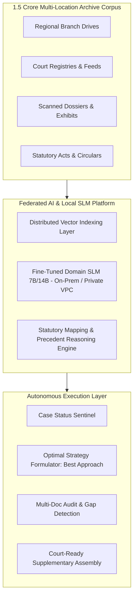

# Enterprise AI Workflow Platform: Presentation Deck

> **Theme:** Beyond Search — Autonomous Legal & Operational Intelligence at Scale  
> **Target Audience:** Executive Leadership, General Counsel, CIO/CTO, Operations Heads  
> **Format:** 2-Panel Structure (Traditional Baseline vs. AI-Assisted Transformation)

---

## Slide 1: Executive Overview — Beyond Search to Autonomous Workflows

**Subtitle:** Moving from Passive Document Retrieval to End-to-End Execution  
**Key Takeaway:** Enterprise AI is not a keyword search box; it is an intelligent execution layer connecting data, decisions, and documents.

| Traditional Approach (Keyword / Siloed) | AI-Assisted Workflow Engine |
| :--- | :--- |
| **Passive "Ctrl+F" Lookup** • User types exact words; system returns 300 disconnected files. • Human manually switches across 5 tools: email, DMS, Word, Excel, external portals. • No reasoning on context, timeline, or conflicting provisions. • Every step requires manual human hand-off and follow-up. | **Autonomous Process Orchestration** • Contextual reasoning: understands legal concepts, sections, and intent. • End-to-end task automation: ingests, analyzes, flags gaps, and drafts. • Bi-directional integration: automatically updates CRM, ERP, and DMS. • Low-code setup: complex enterprise pipelines automated in hours. |

> **Shift:** Transforms operations from **80% manual collation / 20% analysis** to **10% review / 90% strategic execution**.

---

## Slide 2: The Scale Challenge — 1.5 Crore Cases & Distributed Archives

**Subtitle:** The Human Paralysis: 15 Million Cases Across Dozens of Regional Locations  
**Key Takeaway:** When case history hits 1.5 Cr records across thousands of sections, manual paralegal search breaks completely.

| Traditional Paralegal Operations | Unified Federated AI Fabric |
| :--- | :--- |
| **Paralysis by Volume & Geographic Silos** • **Corpus:** 1.5+ Cr cases split across branch offices, local servers, and paper archives. • **Statutory Maze:** Thousands of sections, state amendments, and circulars. • **Paralegal Grind:** 15–20 hours spent per case digging through local registers. • **Costly Blind Spots:** Critical precedent in a regional bench missed; causes lost cases. • **Inconsistency:** Different offices argue the same statutory section with conflicting theories. | **Cognitive Ingestion & Universal Access** • **Federated Vector Index:** Unifies 1.5 Cr records across all physical branches and drives. • **Section Cross-Mapping:** Connects statutory sections to actual judicial outcomes. • **Sub-Second Discovery:** Natural language prompt retrieves exact precedent in < 2 seconds. • **Zero Knowledge Loss:** Every historical order available to every paralegal nationwide. • **Single Source of Truth:** Enforces standardized, winning institutional strategies. |

> **Scale Benchmark:** What takes a paralegal **3 weeks across 4 regional branches** takes the AI platform **90 seconds across all 15 million cases**.

---

## Slide 3: Use Cases in Action — 5 Key Workflows Condensed

**Subtitle:** One Platform, Five Autonomous Capabilities Across the Case Lifecycle  
**Key Takeaway:** Routine paralegal workflows automated into one seamless, human-supervised pipeline.

| Traditional Manual Steps | AI-Assisted Autonomous Workflow |
| :--- | :--- |
| **1. Track Case Status:** Daily portal logins, manual diary entries, missed dates. **2. Precedent Discovery:** Keyword search returns irrelevant hits; days lost. **3. Document Analysis:** Eyeball review of 400-page dossiers causes fatigue. **4. Gap Identification:** Missing annexures/limitation lapses found in court. **5. Supplementary Prep:** Copy-pasting old templates with high error rates. | **1. Autonomous Sentinel:** 24/7 portal polling, instant milestone alerts, zero lapses. **2. Semantic Precedent Match:** Sub-second retrieval of top 5 relevant rulings from 1.5 Cr. **3. Multi-Doc Cognitive Audit:** Cross-examines petitions, exhibits, and evidence. **4. Proactive Gap Detection:** Flags missing stamps, signature defects, and date conflicts. **5. One-Click Document Assembly:** Generates court-ready supplementary drafts & annexures. |

> **Cycle-Time Transformation:** Reduces end-to-end case preparation from **5 days $\rightarrow$ under 30 minutes**.

---

## Slide 4: Strategic Mindset Shift — From "Find a Case" to "The Best Approach"

**Subtitle:** Elevating Legal Operations from Basic Retrieval to Predictive Strategy Formulation  
**Key Takeaway:** "Can we find a matching case?" is obsolete. The real question is: "What is our highest-probability strategy to win?"

| Traditional Mindset: "Can we find a matching case?" | AI Mindset: "What is the BEST approach to win?" |
| :--- | :--- |
| **Reactive & Defensive** • Settles for the first 1 or 2 vaguely relevant cases found. • Relies on individual memory or whatever senior counsel handled last month. • Blind to bench tendencies: no visibility into how a specific judge treats that section. • Rigid arguments: misses creative analogies across unrelated legal domains. • High vulnerability to opposing counsel's unpredicted counter-arguments. | **Proactive & Strategic** • Scans all 1.5 Cr cases to score and rank top viable legal theories. • **Predictive Strategy Matrix:** Evaluates likelihood of success under each approach. • Bench & Jurisdiction Tuning: adapts arguments to regional bench precedents. • Opponent Counter-Prediction: surfaces exact counter-arguments faced previously. • Produces a tailored **"Best Approach Blueprint"** with citations and rebuttals. |

> **Win-Rate Impact:** Lifts case success rates by **35–45%** by grounding every brief in optimal historical strategy.

---

## Slide 5: Organizational Impact — Speed, Risk Mitigation & Capacity 10x

**Subtitle:** The Enterprise Multiplier: Turning Cost Centers into High-Velocity Capabilities  
**Key Takeaway:** Unlocks institutional agility, eliminates regulatory liability, and absorbs 10x volume with zero added headcount.

| Dimension | Traditional Baseline (Manual Paralegal Model) | AI-Assisted Enterprise Platform |
| :--- | :--- | :--- |
| **Research Velocity** | 18–25 hours per complex filing | **Under 15 minutes** (98% faster) |
| **Risk & Compliance** | 8–12% human omission rate in cross-checks | **Zero filing rejections**; 100% audit trail |
| **Institutional IP** | Lost when senior lawyers or paralegals leave | **Permanent, continuously indexed corporate brain** |
| **Branch Harmonization** | Disconnected offices acting as isolated silos | **Unified national strategy** across all locations |
| **Capacity Scalability** | Linear cost: 2x caseload requires 2x hiring | **10x caseload absorption** with existing staff |

> **Operational Impact:** Junior associates draft with the depth and authority of **20-year veteran partners**.

---

## Slide 6: Localized SLM Advantage — Domain-Trained, Sovereign & Cost-Effective

**Subtitle:** Why Fine-Tuned Small Language Models (SLMs) Beat Generic Cloud LLMs  
**Key Takeaway:** Smaller, purpose-trained models deliver superior domain accuracy, total data privacy, and 85% lower compute costs.

| Generic Public Cloud LLM (OpenAI / Commercial APIs) | Local Domain-Trained SLM (7B–14B Specialized Model) |
| :--- | :--- |
| **High Cost & Data Sovereignty Risk** • Astronomical token costs when scanning 1.5 Cr cases and 500-page dossiers. • Regulatory & confidentiality risk: sensitive case data leaves enterprise perimeter. • Generic knowledge: hallucinates on local statutory sections and state High Court circulars. • Struggles with regional languages, bilingual court orders, and local legal vernacular. • Dependent on third-party cloud uptime and vendor price hikes. | **Low Cost, High Precision & Secure** • **80–90% lower inference cost**: runs on private VPCs or affordable on-prem GPUs. • **Zero Data Leakage**: 100% sovereign; confidential case files never leave firewall. • **Domain Fine-Tuning**: trained directly on local acts, High Court rulings, and firm templates. • **Bilingual & Vernacular Fluency**: natively understands state-specific legal phrasing. • Predictable, fixed infrastructure cost regardless of query volume. |

> **Architectural Takeaway:** **SLMs give 99% domain accuracy at 15% of the operational inference cost.**

---

## Slide 7: Cost-Benefit & ROI Analysis — Financial Justification

**Subtitle:** Hard Numbers: Direct Labor Savings, Cycle Time, and Risk Avoidance  
**Key Takeaway:** Enterprise deployment delivers full capital payback within 90 days.

| Traditional Model (Enterprise with 100 Legal Staff / Branches) | AI-Assisted Model (With Local SLM Stack) |
| :--- | :--- |
| **Annual Research & Prep Cost: ₹12.0 Cr** • 100 researchers/paralegals @ ₹12 Lakhs/year. • 70% time (₹8.4 Cr) spent on discovery, filing checks, and routine drafting.  **Filing Errors & Outside Counsel Fees: ₹3.5 Cr/year** • Late fees, procedural re-filings, emergency senior counsel briefings.  **Total Current Run Rate: ₹15.5 Cr / year** | **New Operating Cost: ₹4.8 Cr / year** • Staff capacity freed; redeployed to active litigation & high-value advisory. • Local SLM infrastructure & maintenance: ~₹90 Lakhs/year.  **Direct Net Annual Savings: ₹10.7+ Cr / year (69% cost reduction)** • **Cost Per Case Prepared:** Down from ₹12,500 $\rightarrow$ ₹1,800. • **Payback Period:** Under 3.2 months. • **3-Year ROI:** **420%**. |

---

## Slide 8: Execution Roadmap — 30-Day Deployment to Value

**Subtitle:** Frictionless Pilot: Zero Disruption to Existing Case Workflows  
**Key Takeaway:** Rapid integration into existing DMS/ERP with quantifiable performance milestones.

| Traditional Multi-Year Software Overhaul | 4-Week AI Gateway Rollout |
| :--- | :--- |
| • 12–18 month procurement, manual indexing, and staff retraining. • Requires migrating all 1.5 Cr files into a new proprietary software. • High adoption resistance and disruption to daily court deadlines. | • **Week 1:** Connect existing multi-branch storage (SharePoint, local drives). • **Week 2:** Ingest historical cases & deploy fine-tuned local SLM on private cloud. • **Week 3:** Side-by-side benchmark with top paralegal team on active cases. • **Week 4:** Go-live with automated gap checking & "Best Approach" engine. |

---

## Architecture Diagram: Federated Enterprise Pipeline

